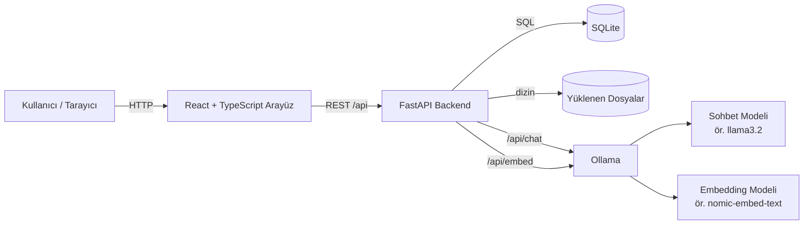
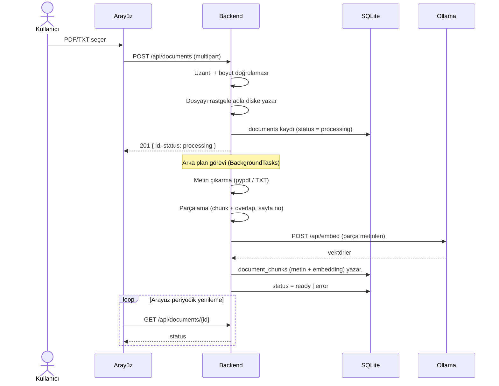
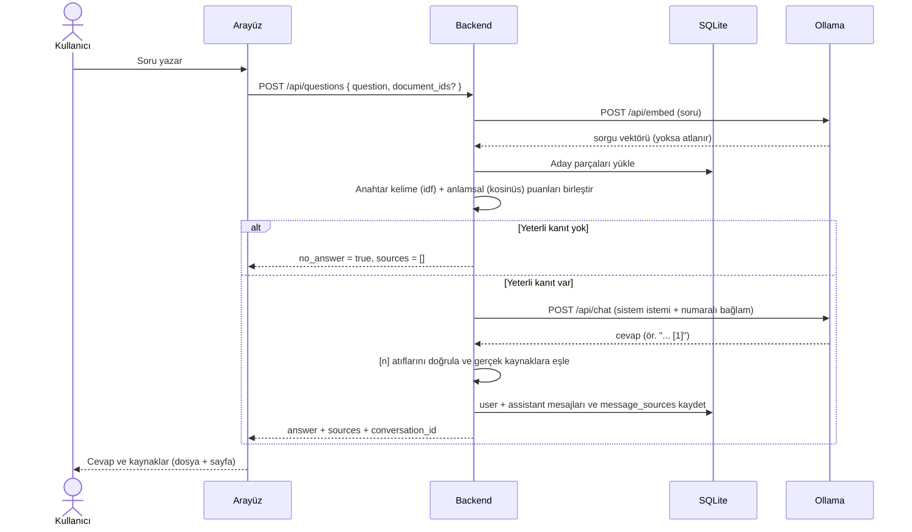
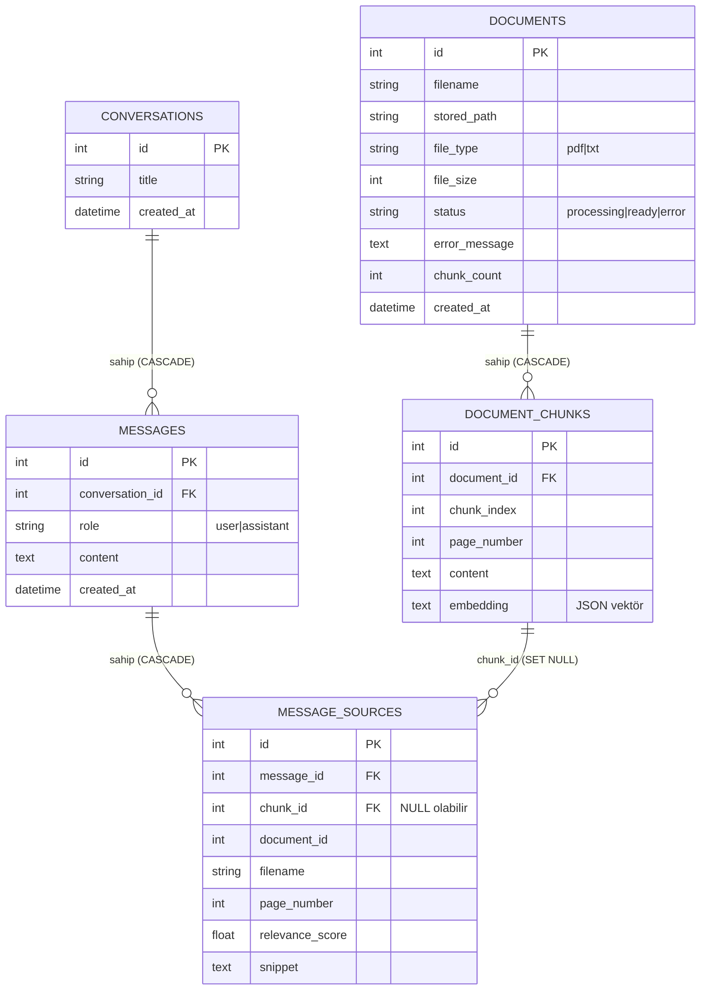

# Mimari ve Veri Akışı

## 1. Bileşenler

| Bileşen | Sorumluluk |
| --- | --- |
| **Arayüz (React + TS)** | Belge yükleme, soru sorma, cevap + kaynak gösterimi, geçmiş yönetimi |
| **Backend (FastAPI)** | Dosya doğrulama/saklama, metin çıkarma, parçalama, arama, RAG hattı, REST API |
| **Ollama** | Yerel **sohbet** modeli (cevap üretimi) ve **embedding** modeli (anlamsal arama) |
| **SQLite + dosya deposu** | Belgeler, parçalar(+embedding), konuşmalar, mesajlar, mesaj kaynakları, yüklenen dosyalar |

## 2. Genel Akış

## 3. Belge Yükleme ve İşleme (indeksleme)

> Embedding modeli kapalıysa işleme **yine tamamlanır** (`status = ready`), ancak parçalar embedding'siz kalır ve yalnızca anahtar kelime araması çalışır.

## 4. Soru-Cevap (RAG) Akışı

**Önemli davranışlar**

- **Kaynak güvenliği:** Model cevabında `[1]`, `[2]` gibi beklediğimiz referansları üretir. Uygulama **yalnızca geçerli numaraları** kabul eder; model uydursa bile gösterilen kaynaklar her zaman gerçek parçalardır. Model hiç atıf yapmazsa, o cevap için getirilen tüm parçalar kaynak olarak sunulur.
- **"Bilgi yok" durumu:** Getirilen en iyi parçanın anahtar kelime puanı `MIN_RELEVANCE_SCORE` altında **ve** anlamsal puanı `MIN_SEMANTIC_SCORE` altında ise model **hiç çağrılmaz** ve doğrudan "yeterli bilgi bulunamadı" yanıtı üretilir.
- **İstem enjeksiyonuna karşı not:** Sistem istemi, bağlam parçalarının *veri* olduğunu, içlerindeki "talimat" benzeri ifadelerin **uygulanmaması** gerektiğini açıkça belirtir.

## 5. Veritabanı Şeması

**Silme davranışı**

- Bir belge silindiğinde parçaları **CASCADE** ile silinir.
- Geçmiş kayıtları korunur: `message_sources.chunk_id` **SET NULL** olur; dosya adı/sayfa/parça metni `message_sources` içinde saklandığı için geçmiş hâlâ okunabilir.
- (SQLite'ta bu davranış için bağlantıda `PRAGMA foreign_keys=ON` etkindir.)

## 6. Yapılandırma Önceliği

`backend/app/core/config.py` ayarları şu sırayla okur:

1. **Ortam değişkenleri** (Docker / CI / kabuk)
2. **`backend/.env`** dosyası
3. Koddaki varsayılanlar

Ayrıntılı liste için [`backend/.env.example`](../backend/.env.example).
